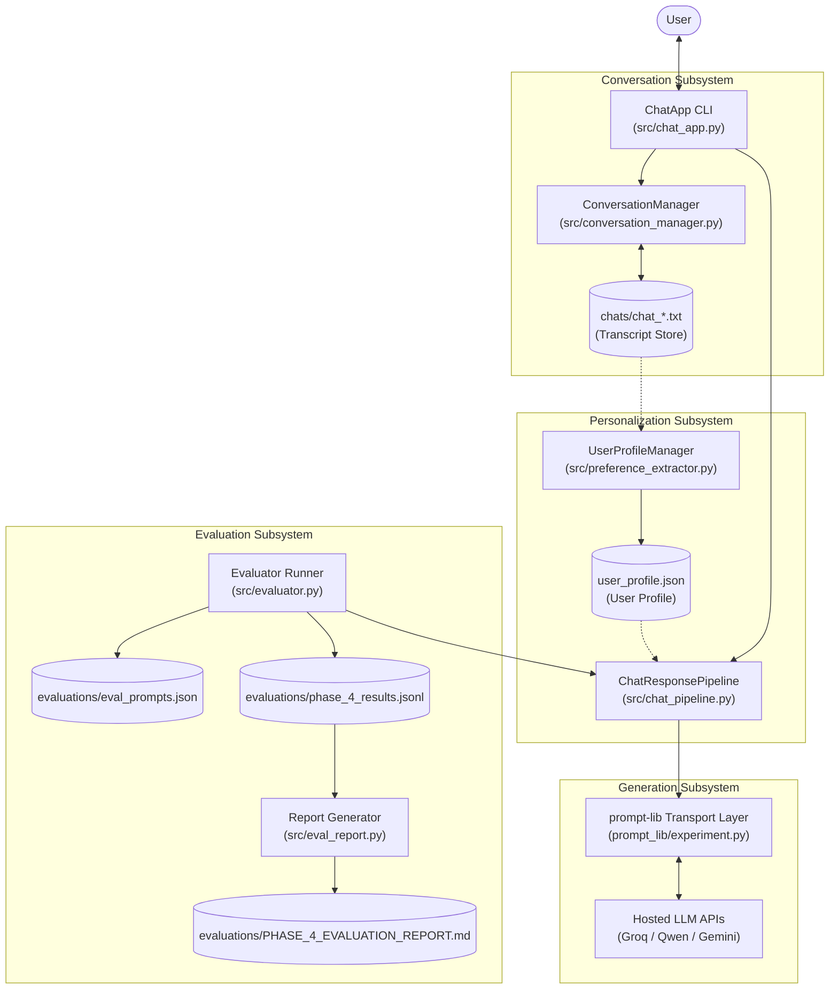
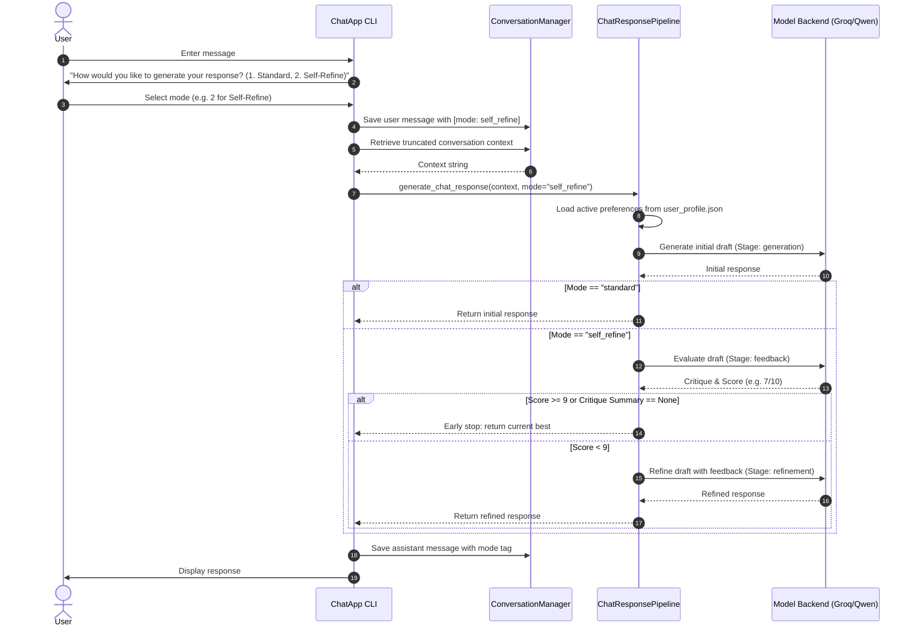
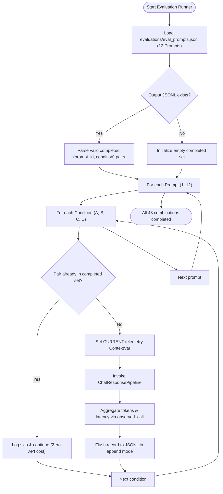

# Self-Refine Improved: Personalized, Multi-Turn Iterative LLM Generation

A modular research implementation and interactive application extending the **Self-Refine** framework ([Madaan et al., 2023](https://arxiv.org/abs/2303.17651)) with persistent multi-turn conversation management, per-message execution mode selection, rule-based user preference mining, basic personalization, and an automated comparative evaluation suite.

---

## Table of Contents
1. [Project Overview](#1-project-overview)
2. [Research Methodology](#2-research-methodology)
3. [Performance Analysis](#3-performance-analysis)
4. [Features](#4-features)
5. [Architecture](#5-architecture)
6. [Technology Stack](#6-technology-stack)
7. [Project Structure](#7-project-structure)
8. [Installation and Setup](#8-installation-and-setup)
9. [Usage Instructions](#9-usage-instructions)
10. [Testing](#10-testing)
11. [Evaluation Instructions](#11-evaluation-instructions)
12. [Current Status and Limitations](#12-current-status-and-limitations)

---

## 1. Project Overview

### Introduction
Large Language Models (LLMs) frequently generate responses containing subtle errors, omissions, or stylistic mismatches on their first pass. The standard **Self-Refine** paradigm addresses this by having an LLM generate an initial answer, provide multi-aspect feedback on its own output, and iteratively refine the answer using that feedback—all without supervised fine-tuning or reinforcement learning.

### Problem Statement & Motivation
While vanilla Self-Refine demonstrates strong benchmark gains on standalone tasks, practical adoption in interactive systems presents three key challenges:
1. **Unconditional Compute Overhead:** Standard Self-Refine unconditionally triggers feedback and refinement loops for every query, doubling or tripling API calls, latency, and token expenditures even for trivial queries where a single-pass response is completely adequate.
2. **Ephemeral Context:** The original framework evaluates isolated prompts without persistent conversational memory, preventing multi-turn dialogue progression.
3. **Uniformity (Lack of Personalization):** Responses treat all users identically, failing to respect individual preferences for explanation depth, conciseness, code simplicity, or pedagogical structure.

### Research Objective
This project implements and evaluates an extended Self-Refine architecture designed to:
- Provide multi-turn conversational persistence with transparent mode tracking.
- Offer **per-message mode selection** (Standard single-pass vs. Self-Refine iterative) to give users direct control over latency and token consumption.
- Automatically extract stylistic preferences from user messages without auxiliary model calls.
- Guide both initial generation and iterative refinement using active user profile constraints.
- Systematically measure the trade-offs in tokens, latency, and response quality across four controlled experimental configurations.

---

## 2. Research Methodology

### Four Experimental Configurations

The core research investigation isolates the interaction between iterative self-refinement and stylistic personalization across four controlled conditions:

| Configuration | Label | Mode | Personalization Profile | Research Purpose |
|:---:|---|---|---|---|
| **A** | Standard Baseline | `standard` (1-pass) | Disabled / None | Establishes baseline one-pass resource usage and raw model output quality. |
| **B** | Self-Refine Baseline | `self_refine` (iterative) | Disabled / None | Quantifies the computational cost and refinement progression of standard Self-Refine. |
| **C** | Personalized Standard | `standard` (1-pass) | Enabled (`test_profile.json`) | Measures the token delta and formatting adherence introduced by personalization alone. |
| **D** | Personalized Self-Refine | `self_refine` (iterative) | Enabled (`test_profile.json`) | Evaluates whether iterative critique preserves or enhances user preference adherence. |

### Comparative Objectives
- **B vs. A:** Measures the latency multiplier and token overhead introduced by the iterative feedback and refinement cycle.
- **C vs. A:** Determines the prompt and completion token overhead of personalizing single-pass answers.
- **D vs. B:** Evaluates whether refinement loops respect user style constraints or tend to revert toward generic responses.
- **D vs. C:** Compares personalized multi-turn refinement against personalized single-pass answers.

### Benchmark Setup
The evaluation suite evaluates **12 standardized prompts** across three cognitive categories:
1. **Programming (4 prompts):** Algorithm implementation (`prog_01`), memory mechanics (`prog_04`), hash collision handling (`prog_02`), and Kadane's maximum subarray sum (`prog_03`).
2. **Theoretical Concepts (4 prompts):** Newton's laws of motion (`theo_01`), TCP vs. UDP transport protocols (`theo_02`), thermodynamic vs. information-theoretic entropy (`theo_03`), and the CAP theorem (`theo_04`).
3. **Reasoning (4 prompts):** Cognitive reflection word algebra (`reas_01`), syllogistic logical validity (`reas_02`), the two-jug riddle (`reas_03`), and the Monty Hall conditional probability problem (`reas_04`).

Each prompt is evaluated under all 4 configurations, resulting in:
$$\text{Total Evaluation Combinations} = 12 \text{ prompts} \times 4 \text{ configurations} = \mathbf{48 \text{ evaluations}}$$

Detailed empirical measurements, token overhead multipliers, and trade-off analysis across all 48 combinations are documented in [Section 3: Performance Analysis](#3-performance-analysis).

---

## 3. Performance Analysis

### Experimental Setup
The comparative evaluation was conducted across all **12 benchmark prompts** in the three cognitive domains:
- **Programming (4 prompts):** `prog_01` (palindrome validation), `prog_02` (hash collision handling), `prog_03` (Kadane's algorithm), `prog_04` (deepcopy vs. shallow copy).
- **Theoretical Concepts (4 prompts):** `theo_01` (Newton's third law forces), `theo_02` (TCP vs. UDP transport layer), `theo_03` (thermodynamic vs. information-theoretic entropy), `theo_04` (CAP theorem trade-offs).
- **Reasoning (4 prompts):** `reas_01` (bat-and-ball algebra), `reas_02` (syllogistic rose deduction), `reas_03` (water jug measurement), `reas_04` (Monty Hall probability distribution).

Each prompt was evaluated under the four conditions:
- **Condition A:** Standard baseline without personalization (`mode: standard`, no profile).
- **Condition B:** Self-Refine baseline without personalization (`mode: self_refine`, no profile).
- **Condition C:** Standard response with personalization (`mode: standard`, `test_profile.json` enabled).
- **Condition D:** Self-Refine with personalization (`mode: self_refine`, `test_profile.json` enabled).

Total combinations evaluated: $12 \text{ prompts} \times 4 \text{ conditions} = \mathbf{48 \text{ evaluations}}$.

### Model Configuration
- **Evaluated Model:** All 48 evaluations were executed using **`groq:qwen/qwen3.8-27b`** (Qwen 2.5 27B hosted on Groq).
- **Pipeline Consistency:** In Self-Refine conditions (B and D), the exact same 27B model was used across all three stages: initial response generation, feedback critique, and iterative refinement.
- **Smaller Refinement Model Status:** The architectural concept of routing feedback or refinement to an alternative smaller model (such as a 7B or 8B parameter model) to reduce compute costs has not yet been evaluated in this benchmark.

### Performance Comparison Table

All 48 prompt-condition combinations completed successfully (100% success rate):

| Condition | Description | Runs | Success Rate | Avg Latency | Avg Prompt Tokens | Avg Completion Tokens | Avg Total Tokens | Avg API Calls |
|:---:|---|:---:|:---:|:---:|:---:|:---:|:---:|:---:|
| **A** | Standard Baseline | 12 | 100.0% | 55.32s | 76.0 | 710.7 | 786.7 | 1.0 |
| **B** | Self-Refine Baseline | 12 | 100.0% | 86.96s | 1062.8 | 1026.4 | 2089.2 | 2.2 |
| **C** | Personalized Standard | 12 | 100.0% | 58.92s | 111.0 | 1245.2 | 1356.2 | 1.0 |
| **D** | Personalized Self-Refine | 12 | 100.0% | 159.54s | 2575.0 | 2353.4 | 4928.4 | 2.6 |

#### All-Attempted vs. Success-Conditioned Averages
In the final dataset, all 48 evaluations succeeded, meaning all-attempted and success-conditioned averages are identical. However, during the initial evaluation run (documented in `evaluations/PHASE_4_FINAL_AUDIT.md`), 8 calls failed due to upstream Groq HTTP 429 rate limits before returning tokens:

| Metric | Condition A (Initial / Final) | Condition B (Initial / Final) | Condition C (Initial / Final) | Condition D (Initial / Final) |
|---|:---:|:---:|:---:|:---:|
| **Initial Completed Runs** | 9 / 12 (75.0%) | 10 / 12 (83.3%) | 10 / 12 (83.3%) | 11 / 12 (91.7%) |
| **Initial All-Attempted Total Tokens** | 597.8 | 1771.8 | 1181.2 | 4801.9 |
| **Initial Success-Only Total Tokens** | 797.1 | 2126.1 | 1417.4 | 5238.5 |
| **Final Recovered Total Tokens (100% Success)** | **786.7** | **2089.2** | **1356.2** | **4928.4** |

When an evaluation fails at the API layer, it records 0 tokens. Calculating aggregate averages across all attempted runs using $N=12$ as the divisor mathematically deflates the reported token cost (by 8% to 25%). Conditioning averages exclusively on successful runs provides the authentic computational cost of completed responses.

### Measured Trade-Off Analysis

#### 1. Standard Generation vs. Self-Refine (B vs. A)
- **Token Multiplier:** Self-Refine increased average total token consumption from **786.7 to 2089.2 tokens**—a **$2.66\times$ token overhead**. Prompt tokens expanded from 76.0 to 1062.8 ($13.98\times$) because the prompt context must carry the draft during feedback and both the draft and critique during refinement.
- **API Call Overhead:** Standard generation consistently makes 1 call. Self-Refine averaged **2.2 calls** in Condition B. The pipeline's convergence early stopping (halting when the feedback score was $\ge 9/10$ or output `Critique Summary: None`) saved an extra refinement call in 5 out of 12 runs, while the remaining 7 runs executed all 3 calls.
- **Latency Multiplier:** Average end-to-end latency increased from **55.32s to 86.96s** (a **$1.57\times$ latency multiplier**), reflecting the additional network round trips and rate-limit queue times.

#### 2. Personalized vs. Non-Personalized Generation (C vs. A)
- **Prompt Token Delta:** Injecting user style preferences (`test_profile.json`) into the prompt increased average prompt tokens by **35.0 tokens** (from 76.0 in A to 111.0 in C, a $+46.1\%$ increase).
- **Completion Token Expansion:** Because the profile requested step-by-step breakdowns, minimalist code, and practical demonstrations, the model generated substantially longer responses: completion tokens grew from **710.7 to 1245.2** ($+75.2\%$).
- **Total Token Impact:** Condition C consumed **1356.2 total tokens** compared to 786.7 in A (a **$+72.4\%$ increase**), while average latency remained comparable (**58.92s vs. 55.32s**).

#### 3. Compounded Overhead of Personalized Self-Refine (D vs. A & D vs. B)
- **Token Compounding:** Combining personalization with iterative refinement produced the highest resource consumption: prompt tokens averaged **2575.0** and completion tokens reached **2353.4**, resulting in **4928.4 total tokens**.
- **Relative Multipliers:**
  - **D vs. A (Baseline):** **$6.26\times$ token overhead** and **$2.88\times$ latency increase** (159.54s vs. 55.32s).
  - **D vs. B (Unpersonalized Self-Refine):** **$2.36\times$ token overhead** (4928.4 vs. 2089.2 tokens).
  - **D vs. C (Standard Personalized):** **$3.63\times$ token overhead** (4928.4 vs. 1356.2 tokens).
- **API Calls:** Condition D averaged **2.6 calls** (4 runs stopped early after 2 calls; 8 runs executed all 3 calls).

#### 4. Practical Architectural Implications
The measured data demonstrates that running unconditional Self-Refine with personalized formatting requires over 6 times the token budget of a standard response. Single-pass generation provides major savings: Condition A saves $62.3\%$ of tokens relative to Condition B and $84.0\%$ relative to Condition D. This empirical result supports the project's design of **per-message mode selection**, allowing users to invoke Self-Refine only when iterative refinement is actually required.

### Limitations
1. **Latency Measurement Confound:** Recorded latency measures end-to-end wall-clock time, which includes provider rate-limit waits and retry backoffs. It should not be interpreted as pure model inference time.
2. **Rate-Limit Recovery:** Initial runs encountered Groq HTTP 429 rate limits on 8 reasoning combinations, which were subsequently recovered using bounded pacing retries.
3. **Benchmark Scope:** The benchmark consists of 12 curated prompts across three categories. It provides exploratory comparative data rather than large-scale statistical bounds.
4. **Qualitative Scoring:** Response quality dimensions (Correctness, Completeness, Clarity, and Preference Adherence) are recorded as placeholders in the JSONL output and have not yet been manually scored with the rubric.

---

## 4. Features

### 1. Conversation Management
- **Multi-Session Storage:** Creates and tracks independent conversations stored as clean text files in the `chats/` directory (e.g. `chat_001.txt`, `chat_002.txt`).
- **Resuming Conversations:** Users can list and resume previous chat threads at any time.
- **Mode Tagging:** Every turn records the exact mode selected by the user for full transparency:
  ```text
  [2026-11-12 21:00:00] USER [mode: standard]:
  Explain TCP.

  [2026-11-12 21:00:02] ASSISTANT [mode: standard]:
  TCP (Transmission Control Protocol) is...
  ```
- **Context Window Management:** Enforces character-based truncation limits (`DEFAULT_MAX_CONTEXT_CHARS = 4000`) while preserving opening turn context.

### 2. Dual Response Generation Modes
- **Standard Response:** Executes a single-pass LLM call. Completely bypasses feedback and refinement to conserve tokens, minimize latency, and reduce API usage for straightforward questions.
- **Self-Refine Response:** Generates an initial draft, solicits targeted critique across relevance, accuracy, and coherence from the feedback model, and synthesizes an improved output.
- **Convergence Early Stopping:** If the initial draft receives a critique of `Critique Summary: None` or scores $\ge 9/10$, the pipeline halts early to avoid redundant refinement calls.
- **Per-Message Prompting:** Users choose between Standard and Self-Refine mode for every message sent.

### 3. Rule-Based Preference Extraction
- **Zero-Model-Call Extraction:** Inspects historical user messages across `chats/` using deterministic regular expressions without invoking additional LLM inference calls.
- **Supported Style Preferences:**
  - `prefers_step_by_step`: Explanations structured sequentially.
  - `prefers_concise_answers`: Direct, compact responses.
  - `prefers_simple_code`: Minimalist, dependency-free implementations.
  - `prefers_examples`: Concrete illustrations and demonstrations.
- **Profile Persistence:** Stores detected preferences in `user_profile.json`. Preserves manual user modifications (e.g. toggling `"enabled": false`) across subsequent extractions without creating duplicates.

### 4. Basic Personalization
- **Profile Injection:** Reads enabled preferences from `user_profile.json` and compiles them into a unified prompt instruction.
- **Cross-Mode Compatibility:** Injects personalization instructions into both Standard mode and Self-Refine mode (including initial generation, feedback rubric criteria, and refinement prompts).
- **Graceful Fault Tolerance:** Continues normal generation without interruption if `user_profile.json` is missing, empty, or syntactically invalid.

### 5. Automated Evaluation Framework
- **Automated Execution:** Tests all 4 experimental conditions (A, B, C, D) over standardized evaluation prompts.
- **Telemetry Recording:** Measures prompt tokens, completion tokens, total tokens, latency in seconds, and individual call stages.
- **Resume Capability:** Reads existing JSONL records and skips already-completed successful prompt/condition combinations, surviving rate-limit interruptions.
- **Markdown Reporting:** Converts raw JSONL evaluation telemetry into structured Markdown comparative tables.

---

## 5. Architecture

### Overall System Architecture



### Chat Response Workflow



### Evaluation Workflow



---

## 6. Technology Stack

### Languages & Runtime
- **Python 3.12:** Primary programming language.
- **PowerShell 5.1 / 7+:** Standard Windows execution shell.

### Core Libraries & Frameworks
- **`openai` (0.28.x API compatibility):** Transport interface for OpenAI-compatible hosted completions.
- **`requests` ($\ge 2.31.0$):** Underlying HTTP transport for Hugging Face Inference Providers and Groq API endpoints.
- **`google-generativeai`:** Client SDK for Google Gemini models (`gemini-3.5-flash-lite`, `gemini-1.5-flash`).
- **`spacy` ($\ge 3.8.0$) & `en_core_web_sm`:** Industrial NLP library used for lemmatization in concept detection.
- **`nltk`:** Word and sentence tokenization utilities.
- **`pandas` & `numpy`:** Prompt dataset serialization, JSONL handling, and numerical evaluations.
- **`python-dotenv`:** Secure local credential management without exposing API keys.

### Hosted Model APIs & Endpoints
- **Groq Hosted API (`groq:qwen/qwen3.8-27b`):** High-throughput inference for chat pipeline generation, feedback critique, and benchmark evaluations.
- **Hugging Face Inference Router (`hf:`):** Open-source model inference provider endpoints.
- **Google Gemini API:** Benchmark baseline model backend.

---

## 7. Project Structure

```text
self-refine/
├── chats/                              # Saved conversation transcripts (*.txt)
│   ├── chat_001.txt                    # Sequential multi-turn chat log
│   └── chat_002.txt                    # Sequential multi-turn chat log
├── data/                               # Legacy benchmark prompt data
│   └── prompt/                         # Task-specific few-shot examples
├── evaluations/                        # Comparative evaluation suite
│   ├── eval_prompts.json               # 12 standardized benchmark prompts
│   ├── test_profile.json               # Standardized profile for conditions C and D
│   ├── smoke_test_results.jsonl        # Verified 1-prompt smoke test output
│   ├── phase_4_results.jsonl           # Complete 48-combination evaluation dataset
│   ├── PHASE_4_EVALUATION_REPORT.md    # Generated comparative markdown report
│   └── README.md                       # Evaluation suite documentation
├── prompt-lib/                         # Unified model backend and telemetry library
│   ├── prompt_lib/
│   │   ├── backends/                   # Provider adapters (Groq, HF, Gemini, OpenAI)
│   │   │   ├── groq_api.py             # Groq hosted chat adapter
│   │   │   ├── groq_pacing.py          # Request pacing & retry delay calculation
│   │   │   ├── huggingface_api.py      # HF router adapter & Groq fallback
│   │   │   ├── gemini_api.py           # Gemini API adapter
│   │   │   └── request_budget.py       # Local request ceiling enforcement
│   │   └── experiment.py               # Call telemetry (observed_call) & routing
│   └── README.md                       # Upstream prompt-lib documentation
├── src/                                # Core project source code
│   ├── acronym/                        # Acronym generation benchmark task
│   ├── commongen/                      # CommonGen constrained generation task
│   ├── gsm/                            # GSM math reasoning benchmark task
│   ├── pie/                            # PIE Python efficiency benchmark task
│   ├── readability/                    # Code readability benchmark task
│   ├── responsegen/                    # Dialogue response benchmark task
│   ├── sentiment_reversal/             # Sentiment transfer benchmark task
│   ├── chat_app.py                     # Interactive CLI chat application
│   ├── chat_pipeline.py                # Generation, feedback, & refinement pipeline
│   ├── conversation_manager.py         # Multi-turn history management & TXT storage
│   ├── eval_report.py                  # Evaluation aggregator & report generator
│   ├── evaluator.py                    # Standalone 4-condition evaluation runner
│   ├── experiment.py                   # Benchmark experiment harness
│   ├── output.py                       # Output formatting & secret redaction
│   ├── preference_extractor.py         # Rule-based user preference mining
│   ├── utils.py                        # Prompt base class & retry wrappers
│   └── README.md                       # Source module documentation
├── tests/                              # Hermetic unit & regression test suite
│   ├── test_chat_app.py                # Interactive CLI tests
│   ├── test_chat_pipeline.py           # Pipeline, early stopping, & stop-token tests
│   ├── test_conversation_manager.py    # Conversation creation & persistence tests
│   ├── test_evaluator.py               # Evaluator telemetry & resume logic tests
│   ├── test_groq_fallback.py           # Provider fallback & rate-limit tests
│   ├── test_inference.py               # Task routing & NLP evaluation tests
│   ├── test_preference_extractor.py    # Preference detection & profile update tests
│   └── README.md                       # Test suite documentation
├── .env.example                        # Template for required environment variables
├── .gitignore                          # Version control exclusions
├── PHASE_4_EVALUATION_PLAN.md          # Evaluation methodology plan
├── README.md                           # Master project documentation (this file)
├── requirements.txt                    # Project dependency manifest
└── user_profile.json                   # Local user preference profile
```

---

## 8. Installation and Setup

### Prerequisites
- Windows 10/11 operating system.
- Python 3.12 installed and accessible via `py -3.12` or `python`.
- Git for Windows.

### 1. Clone the Repository
Open PowerShell and clone the project:
```powershell
git clone <repository-url>
cd self-refine
```

### 2. Create and Activate a Virtual Environment
```powershell
py -3.12 -m venv .venv-research
.\.venv-research\Scripts\Activate.ps1
```

### 3. Install Required Dependencies
Install the pinned requirements and local `prompt-lib` package:
```powershell
.\.venv-research\Scripts\python.exe -m pip install --upgrade pip
.\.venv-research\Scripts\python.exe -m pip install -r requirements.txt
.\.venv-research\Scripts\python.exe -m pip install -e ./prompt-lib
```

### 4. Configure Environment Credentials
Copy `.env.example` to create your local `.env` file:
```powershell
Copy-Item .env.example .env
```
Open `.env` in an editor and insert your actual API keys. **Never commit `.env` to version control.**

```ini
# Primary inference model for interactive chat and evaluations
GROQ_API_KEY=gsk_your_actual_groq_key_here
GROQ_MODEL_ID=qwen/qwen3.8-27b

# Automatic retry/resume on Groq TPM/RPM 429 rate limits (default: false)
GROQ_RESUME_ON_RATE_LIMIT=true

# Optional Google Gemini credentials for baseline comparisons
GEMINI_API_KEY=your_actual_gemini_key_here
LLM_ENGINE=gemini-3.5-flash-lite

# Optional Hugging Face credentials for legacy benchmarks
HF_TOKEN=your_actual_hf_token_here
```

---

## 9. Usage Instructions

### 1. Launch the Interactive Chatbot
Run the terminal chat application:
```powershell
$env:PYTHONPATH = ".;prompt-lib"
.\.venv-research\Scripts\python.exe -m src.chat_app
```

### 2. Chat Navigation Workflow
1. **Start a New Chat:** Select `1` from the main menu. You can provide an explicit title or press Enter to automatically title the chat from your first query.
2. **Select Response Mode:** For every message sent, the CLI prompts:
   ```text
   How would you like to generate your response?
   1. Standard Response
   2. Self-Refine Response
   Select an option (1 or 2):
   ```
   - Enter `1` for immediate, single-pass generation.
   - Enter `2` for iterative generation with critique and refinement.
3. **Return to Menu / Exit:** Type `menu` to save and return to the main menu; type `quit` or `exit` to exit the application.
4. **Continue Previous Chat:** Select `2` from the main menu to display existing conversations stored in `chats/` and resume any previous thread with full history intact.

### 3. Extracting User Preferences
Scan conversation logs across `chats/` to detect recurring style preferences and update `user_profile.json`:
```powershell
$env:PYTHONPATH = ".;prompt-lib"
.\.venv-research\Scripts\python.exe -m src.preference_extractor
```

### 4. Configuring Personalization
Preferences are stored in `user_profile.json`:
```json
{
  "last_updated": "2026-11-12 23:00:00",
  "preferences": {
    "prefers_step_by_step": {
      "description": "Prefers step-by-step explanations",
      "enabled": true
    },
    "prefers_simple_code": {
      "description": "Prefers simple and clean code implementations",
      "enabled": true
    },
    "prefers_examples": {
      "description": "Prefers practical examples and demonstrations",
      "enabled": true
    }
  }
}
```
You can manually edit this file at any time to toggle preferences (`"enabled": false`). The chat pipeline automatically respects these toggles during response generation.

---

## 10. Testing

The test suite runs **offline** using mocked API responses, validating logic, prompt formatting, telemetry aggregation, and error recovery without incurring API costs.

### Running the Complete Test Suite
```powershell
$env:PYTHONPATH = ".;prompt-lib"
.\.venv-research\Scripts\python.exe -m unittest discover -s tests -p "test_*.py" -v
```

### Running Specific Test Modules
```powershell
# Evaluator telemetry, resume logic, and report formatting
.\.venv-research\Scripts\python.exe -m unittest tests.test_evaluator -v

# Pipeline refinement cycles, early stopping, and stop tokens
.\.venv-research\Scripts\python.exe -m unittest tests.test_chat_pipeline -v

# Preference extraction rules and profile updating
.\.venv-research\Scripts\python.exe -m unittest tests.test_preference_extractor -v

# Conversation file persistence and mode tagging
.\.venv-research\Scripts\python.exe -m unittest tests.test_conversation_manager -v

# Interactive CLI menu and input flows
.\.venv-research\Scripts\python.exe -m unittest tests.test_chat_app -v

# Provider switching, quota failover, and request pacing
.\.venv-research\Scripts\python.exe -m unittest tests.test_groq_fallback -v

# Task routing and NLP concept extraction
.\.venv-research\Scripts\python.exe -m unittest tests.test_inference -v
```

---

## 11. Evaluation Instructions

The comparative evaluation suite tests the four configurations (A, B, C, D) across all 12 standardized prompts.

### 1. Launching the Evaluation
```powershell
$env:PYTHONPATH = ".;prompt-lib"
.\.venv-research\Scripts\python.exe -m src.evaluator --output evaluations/phase_4_results.jsonl
```

### 2. Resuming an Interrupted Run
If the process is interrupted by Groq rate limits (`HTTP 429`) or a manual interrupt (`Ctrl+C`):
- All successfully completed records remain safely preserved in `evaluations/phase_4_results.jsonl`.
- Simply rerun the same command:
  ```powershell
  .\.venv-research\Scripts\python.exe -m src.evaluator --output evaluations/phase_4_results.jsonl
  ```
- The evaluator automatically parses existing records, logs `Skipping already completed [prompt_id] Condition [condition_key]`, and continues only with the remaining combinations.

### 3. Understanding the JSONL Record Structure
Each line in `evaluations/phase_4_results.jsonl` contains detailed telemetry:
```json
{
  "prompt_id": "prog_01",
  "category": "Programming",
  "condition_key": "B",
  "condition_name": "Self-Refine without personalization",
  "mode": "self_refine",
  "personalization_enabled": false,
  "query": "Write a Python function to check whether a given string is a valid palindrome...",
  "response": "```python\ndef is_palindrome(s: str) -> bool:...",
  "status": "success",
  "error": null,
  "telemetry": {
    "api_call_count": 2,
    "latency_seconds": 2.5171,
    "prompt_tokens": 347,
    "completion_tokens": 329,
    "total_tokens": 676,
    "calls": [
      {"stage": "generation", "usage": {"prompt_tokens": 73, "completion_tokens": 136, "total_tokens": 209}},
      {"stage": "feedback", "usage": {"prompt_tokens": 274, "completion_tokens": 193, "total_tokens": 467}}
    ]
  },
  "evaluation_placeholders": {
    "correctness": null,
    "completeness": null,
    "clarity": null,
    "preference_adherence": null
  }
}
```

### 4. Generating the Markdown Summary Report
```powershell
.\.venv-research\Scripts\python.exe -m src.eval_report --results evaluations/phase_4_results.jsonl --output evaluations/PHASE_4_EVALUATION_REPORT.md
```

---

## 12. Current Status and Limitations

### Implemented Capabilities
- [x] **Conversation Management:** Multi-conversation creation, TXT persistence in `chats/`, sequential ID generation, and context window truncation.
- [x] **Execution Mode Selection:** Per-message user selection between Standard (1-pass) and Self-Refine (iterative) modes, with mode tags recorded in transcripts.
- [x] **Preference Extraction:** Rule-based detection of stylistic preferences from chat history into `user_profile.json` without extra model calls.
- [x] **Profile-Driven Personalization:** Profile-based prompt conditioning across both Standard and Self-Refine execution modes.
- [x] **Evaluation Framework:** Automated 48-combination evaluation suite, telemetry logging (tokens, latency, API call stages), resume and recovery logic, and Markdown report generation.
- [x] **Test Coverage:** Hermetic unit and integration tests covering the chat pipeline, conversation manager, evaluator, and fallback pacing.

### Methodological Limitations
- **Latency Includes Rate-Limit Delays:** Measured latency captures end-to-end wall-clock time, including provider rate-limit wait times and retry cooldowns. It does not measure pure model decoding speed.
- **Benchmark Scope ($N=12$):** The benchmark comprises 12 prompts across three task domains. While sufficient for inspecting behavior and measuring overhead, it is an exploratory evaluation.
- **Model Homogeneity:** All three stages (initial generation, feedback critique, and refinement) use the same 27B model (`groq:qwen/qwen3.8-27b`). Smaller-model refinement was not tested in this benchmark.
- **Qualitative Rubric Scoring:** Quality dimensions (Correctness, Completeness, Clarity, and Preference Adherence) are archived as rubric placeholders in `phase_4_results.jsonl` and require manual scoring.
- **Rule-Based Extraction Scope:** The preference extractor uses regex and keyword heuristics; complex or implicit stylistic preferences currently require manual editing in `user_profile.json`.

---

## References
- Madaan, A., Tandon, N., Gupta, P., Hallinan, S., Gao, L., Wiegreffe, S., Alon, U., Dziri, N., Prabhumoye, S., Yang, Y., Welleck, S., Majumder, B. P., Gupta, S., Yazdanbakhsh, A., & Clark, P. (2023). *Self-Refine: Iterative Refinement with Self-Feedback*. Advances in Neural Information Processing Systems (NeurIPS 2023). [arXiv:2303.17651](https://arxiv.org/abs/2303.17651).
