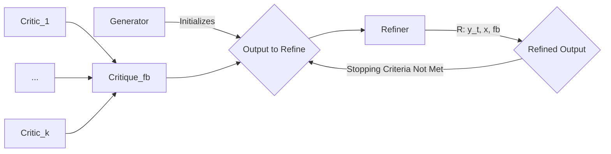

# Self-Refine: current workspace guide

Status checked: **23 October 2026**. This project is a command-line research
application that generates an answer, asks a model for feedback, and uses that
feedback to refine the answer. It uses hosted model APIs; it does not run a local
LLM or start a web server.

## Current status

| Area | Status |
| --- | --- |
| Qwen through Groq | Working in saved live runs |
| Two refinements | Confirmed: initial answer, feedback, refinement 1, feedback, refinement 2, feedback |
| Rate-limit recovery | Confirmed in saved live runs and mocked tests; retries only the unfinished HTTP call |
| Readable output | Markdown report alongside JSONL research data |
| Checkpoints | Parsed/scored dialogue answers saved to disk during a run |
| Request budget | 56 of 700 used at this status check; this snapshot changes with future calls |
| Offline suite | 41 tests run: 40 passed, 1 failed |
| Known test failure | CommonGen's spaCy dependency cannot load `srsly.ujson`: Windows Application Control blocks its DLL |
| HF refinement | Locally configured; successful live HF inference remains unverified; earlier runs returned HTTP 402 |
| Running process | No experiment process was running at the status check |
| Version control | Local modified/untracked files remain; these updates have not been committed or pushed |

Evidence of completed two-refinement runs:

- [Newton's third law report](newton-qwen-20261023-170008-492.md)
- [Latest saved query report](newton-qwen-20261023-170233-608.md)

These files demonstrate software execution, not independent validation of answer
accuracy or proof that refinement always improves quality.

## 1. Open the project

Use PowerShell:

```powershell
cd "C:\Users\Ashitosh Shirsath\Desktop\Parth\self-refine"
```

The working interpreter is `.venv-research\Scripts\python.exe` (Python 3.12).
The older `venv` environment is not the supported runner in this workspace.

The existing workspace already has dependencies installed. For a new environment:

```powershell
py -3.12 -m venv .venv-research
.\.venv-research\Scripts\python.exe -m pip install -r requirements.txt
```

The local `prompt-lib` directory is required. Keep its source with the project.
The budget database described below must also be present: a fresh checkout with
no ledger deliberately blocks Groq/HF calls. Do not recreate/reset the current
workspace ledger as an installation step; that would lose the existing count.

## 2. Configure credentials

Keep credentials only in your local `.env`, using `.env.example` for the setting
names. Do not replace an existing `.env` with the example. For the default query
runner, the required credential is:

```dotenv
GROQ_API_KEY=your_private_groq_key
```

Never paste real keys into result files, source code, commits or chat. Replace
any previously exposed key. Existing process environment variables override
`.env`; restart or update your shell if it still contains an old key.
The script sets model routing through its JSON configuration, so changing
`GROQ_MODEL_ID` alone does not override its explicitly selected model.

## 3. Run an initial answer and two refinements

```powershell
.\run-query.ps1 -Query "Explain Newton's third law." -Attempts 3
```

Change the quoted query to your own question. Run one experiment at a time for
easier quota management. The PowerShell script supplies the Python path, UTF-8
output, model configuration, unique output filename and rate-limit recovery.

| Attempts | Answers produced | Model calls without rate-limit rejections |
| --- | --- | --- |
| 1 | Initial answer | 2: generation and feedback |
| 2 | Initial answer + refinement 1 | 4 |
| 3 | Initial answer + refinements 1 and 2 | 6 |
| 4 | Initial answer + three refinements | 8 |

`Attempts` counts answers, including the initial generation. The script accepts
1 through 10. Even `Attempts 1` runs feedback because the script uses variant B.
For a one-call generation baseline, use `experiments/A-qwen-groq.json` with the
Python CLI below instead.

## 4. What happens during a run

1. The generator receives the question and the existing dialogue examples.
2. A feedback call scores the initial answer using the existing rubric.
3. A refinement call receives previous answer(s), their context and feedback.
4. Feedback scores the refinement.
5. Steps 3 and 4 repeat until the requested number of answers is reached.
6. A complete run selects the answer with the highest model score (the first
   candidate wins a tie). The selected answer may be an earlier answer.

The default runner uses `groq:qwen/qwen3.8-27b` for generation, feedback and
refinement. The configured dialogue output budget is 2048 tokens per stage;
responses can span multiple lines and need not contain a `Response:` label.
Model feedback is a proxy, not independent evaluation, and may reward incorrect
answers. Review factual answers yourself before relying on them.

## 5. When Groq reports a rate limit

Successful requests have **no fixed delay**. The script enables
`GROQ_RESUME_ON_RATE_LIMIT=true`:

- HTTP 429 pauses for Groq's `Retry-After` duration, including HTTP-date headers.
- If no valid wait is supplied, the fallback pause is 65 seconds.
- The same prompt is retried for the unfinished stage; completed stages are not
  restarted. If feedback on refinement 1 failed, that feedback finishes before
  refinement 2 is requested.
- There are at most five additional attempts per stage. A requested cooldown
  longer than one hour stops instead of retrying early. Other Groq errors stop
  immediately.
- Keep the terminal open. This is automatic recovery within the same process,
  not automatic restart from a checkpoint after closing PowerShell.

Groq request/token quotas still apply. A cooldown cannot guarantee recovery from
a daily quota or make an oversized request fit. Other applications using the
same account may affect available quota. Direct Python/adapter use must enable
the recovery flag explicitly if this behavior is wanted.

## 6. Read the output

The script prints the saved file paths. Each run uses a unique `newton-qwen-...`
prefix even for questions unrelated to Newton.

| File | Purpose |
| --- | --- |
| `newton-qwen-....md` | Open this first: question, final answer, actual models, tokens, answer history and feedback |
| `newton-qwen-....jsonl` | Full result, per-call telemetry, settings and reproducibility metadata |
| `newton-qwen-....jsonl.checkpoint.json` | Backup of the latest parsed/scored answers during the run |

On an interrupted run with a completed answer, status is `partial`. The latest
completed answer is preserved, missing scores stay null, and the report explains
what failed. That answer is not claimed to be the best-scored answer. If initial
generation fails, status is `error` with no invented answer. Disk checkpoints
are backups and do not have a supported cross-process resume command yet.

CLI exit codes: **0** = completed, **1** = failed, **2** = partial.
Existing output and report files cannot be overwritten by the experiment CLI.

Convert an older JSONL result without API calls, choosing a new report path:

```powershell
$env:PYTHONPATH = '.;prompt-lib'
.\.venv-research\Scripts\python.exe -m src.report newton-qwen-groq-verified.jsonl --output readable-example.md
```

## 7. The 700-request cap

`.cache/request-budget.sqlite3` stores a persistent, atomic counter shared by
this checkout's Groq and HF hosted-chat adapters. Every network attempt reserves
a slot before submission, including failed calls, rate-limit rejections and
fallbacks. Waiting consumes no slot. At 700, requests are blocked. Missing or
unreadable ledgers also block calls. The count does not reset daily.

**Do not delete, replace or reset the ledger.** The count starts from the budget
feature's introduction; it does not reconstruct earlier usage. It cannot track
other applications, other checkouts, or legacy Gemini/OpenAI backends. The local
cap is separate from Groq's account quotas. The 56/700 figure above is only a
snapshot; inspect the live local counter with the offline command below.

## 8. Check models and budget without spending quota

```powershell
$env:PYTHONPATH = '.;prompt-lib'
.\.venv-research\Scripts\python.exe -m src.check_config --config experiments/B-qwen-groq.json
.\.venv-research\Scripts\python.exe -m src.check_config --config experiments/C.json
```

These commands show resolved stage models, credential presence and the local
budget. They make no API requests and do not verify billing or provider access.

| Configuration | Behavior |
| --- | --- |
| `A-qwen-groq.json` | One Qwen/Groq generation, no feedback |
| `B-qwen-groq.json` | Qwen/Groq generation, feedback and refinements; default script configuration |
| `C.json` | Original configured generation/feedback; HF Qwen refinement; fallback disabled under the checked environment |
| `C-groq-fallback.json` | C with eligible HF HTTP 402/429 refinement failures allowed to fall back to Groq |

At the local check, C resolved to Gemini generation/feedback and
`hf:Qwen/Qwen3-4B-Instruct-2507:nscale` refinement. C inherits settings from the
environment, so rerun preflight after configuration changes. The HF token was
present, but successful live inference remains unverified. Previous HF requests
returned payment/credit error HTTP 402. Groq Qwen3.8-27B and HF Qwen3-4B are
different models. A Groq baseline is not a refinement-only HF experiment.
An unused HF default in a B manifest does not imply an HF call; consult actual
call records and the readable report.

## 9. Advanced Python command

Equivalent to a three-answer query run, using a fresh output path:

```powershell
$env:PYTHONPATH = '.;prompt-lib'
$env:PYTHONIOENCODING = 'utf-8'
$env:GROQ_RESUME_ON_RATE_LIMIT = 'true'
$outputFile = 'query-' + (Get-Date -Format 'yyyyMMdd-HHmmss-fff') + '.jsonl'
.\.venv-research\Scripts\python.exe -u -m src.experiment `
  --config experiments/B-qwen-groq.json `
  --task responsegen `
  --query "User: Explain Newton's third law." `
  --output $outputFile `
  --max-attempts 3
```

For batch input, replace `--query` with `--input your-dataset.jsonl` and provide
one JSON object per line with a `context` field. Use JSONL as the authoritative
batch history; the checkpoint file is updated for the current record.

## 10. Run offline tests

```powershell
$env:PYTHONPATH = '.;prompt-lib'
$env:PYTHONIOENCODING = 'utf-8'
$env:NLTK_DATA = Join-Path $PWD '.cache/nltk_data'
.\.venv-research\Scripts\python.exe -m unittest discover -s tests -v
```

Tests use mocked provider responses or temporary budget databases. They do not
spend model quota. The current suite has 40 passing tests and one CommonGen
failure caused by the blocked NLP-library DLL. Dialogue recovery, two-refinement
execution, reports, counter boundaries and concurrent budget reservations pass.
Fixing the CommonGen environment requires an application-control-approved NLP
installation; no system policy was changed as part of this work.

## Files to know

- `run-query.ps1`: simple PowerShell entry point.
- `src/experiment.py`: experiment execution, manifests, partial results and reports.
- `src/responsegen/`: generation, scoring, parsing and refinement loop.
- `src/report.py`: offline readable report conversion.
- `src/check_config.py`: offline configuration and budget inspection.
- `prompt-lib/prompt_lib/backends/`: provider transports, cooldown handling and budget guard.
- `experiments/`: model/stage configurations.
- [Additional Groq workflow details](docs/working-groq.md).
- [Research methodology](docs/qwen-experiments.md).
- [Offline HF configuration check](reports/hf-configuration-check.md).

---

# Original project documentation

The upstream setup and task-specific documentation follows. Its legacy commands
are separate from the current PowerShell workflow above.

# Self-Refine: Iterative Refinement with Self-Feedback

_With Self-Refine, LLMs can generate feedback on their work, use it to improve the output, and repeat this process._


<center><h4> <a href="https://selfrefine.info"> Website </a> | <a href="https://arxiv.org/pdf/2303.17651.pdf">Paper</a> </h4></center>
<hr>


<!-- START doctoc generated TOC please keep comment here to allow auto update -->
<!-- DON'T EDIT THIS SECTION, INSTEAD RE-RUN doctoc TO UPDATE -->
**Table of Contents**

- [Updates](#updates)
- [Setup](#setup)
- [Getting Started with Acronym Generation](#getting-started-with-acronym-generation)
- [Dialogue Response Generation](#dialogue-response-generation)
- [Code Readability Improvement](#code-readability-improvement)
- [Commongen](#commongen)
- [GSM-8k](#gsm-8k)
- [Yelp](#yelp)
- [PIE](#pie)
- [General setup](#general-setup)
- [Citation](#citation)

<!-- END doctoc generated TOC please keep comment here to allow auto update -->

<hr>

## Updates

- **Nov 2023**: Added [visual self-refine examples](docs/visual_self_refine_examples/) and [colabs](colabs/Visual-Self-Refine-GPT4V.ipynb). Use GPT4-V to write tikz code for diagrams, and improve them iteratively.

<p align="center">
  <strong>Stokes' Theorem Example</strong><br>
  
</p>
<p align="center">
  <strong>Unicorn Example</strong><br>
  
</p>


## Setup

For controlled A/B/C experiments with **Qwen3 only at the refinement stage**, see
[Qwen3 setup, methodology, metrics and validation](docs/qwen-experiments.md).
The existing commands below retain their original behavior.
See the [executed validation report](reports/validation-report.md) for test results,
hosted API limitations, and terminal/saved-output examples.
For HF quota failures, see [optional Groq backup and Groq-only commands](docs/groq-fallback.md).

* We use [prompt-lib](https://github.com/reasoning-machines/prompt-lib) for querying LLMs. You can install `prompt-lib` by running the following commands:

```sh
git clone https://github.com/reasoning-machines/prompt-lib
pip install prompt-lib/
```

Depending on your default settings, you may want to use the following to set a PYTHONPATH:

```sh
export PYTHONPATH=".:../:.:src:../:../../:.:prompt-lib"
```

## Getting Started with Acronym Generation


```sh
python -u src/acronym/run.py "Using language models of code for few-shot commonsense"
```

* Since we sample with temperature 0.7, you'll get different results each time you run the above command.


```swift
0 INIT> Using language models of code for few-shot commonsense

0 GEN> CLoCK
0 SCORES> * Ease of pronunciation: CLoCK is pronounced "clah-k". This is easy acronym to pronounce. 4/5 
* Ease of spelling: CLoCK is easy to spell. 5/5 
* Relation to title: CLoCK stands for "Code Language Models of Commonsense Knowledge" which is related to the title. 5/5 
* Positive connotation: CLoCK is a positive acronym. It implies accuracy and efficiency. 5/5 
* Well-known: CLoCK is not a well-known acronym. 2/5

* Total score: 21/25

1 GEN> CMNSC
1 SCORES> * Ease of pronunciation: CMNSC is pronounced "see-min-es-see". This is a difficult acronym to pronounce. 1/5 
* Ease of spelling: CMNSC is difficult to spell. 1/5 
* Relation to title: CMNSC stands for "Commonsense" which is related to the title. 4/5 
* Positive connotation: CMNSC is a neutral acronym. 3/5 
* Well-known: CMNSC is not a well-known acronym. 1/5

* Total score: 10/25

2 GEN> COMMIT
2 SCORES> * Ease of pronunciation: COMMIT is pronounced "com-mit". This is an easy acronym to pronounce. 4/5
* Ease of spelling: COMMIT is easy to spell. 5/5
* Relation to title: COMMIT stands for "Commonsense Model of Code for Intuitive Training" which is related to the title. 5/5 
* Positive connotation: COMMIT is a positive acronym. It implies commitment and dedication. 5/5
* Well-known: COMMIT is not a well-known acronym. 2/5

* Total score: 21/25
```

<hr>


## Dialogue Response Generation

```sh
PYTHONPATH="." python -u src/responsegen/run.py --output <OUTPUT FILE> --size <DATA SIZE>
```

- Use size 0 for running on all test instances

<hr>


## Code Readability Improvement


* Note: Please unzip 'data/tasks/codeclean/code_readability/codenet-python-train.jsonl.zip' before running the following commands!

- Running:
```sh
PYTHONPATH="." python -u src/readability/readability.py --output <OUTPUT FILE>
```

- Evaluation:
```sh
PYTHONPATH="." python -u src/readability/{count_comment|count_function|count_meaningful_var}.py --file <INPUT FILE>
```


<hr>


## Commongen

* We use a hard version of commongen. The data is located in `data/prompt/commongen`. You can download the data by running the following commands:

```sh
python -u src/commongen/run.py cmd stair bubble team dryer puppy aliens cat 
```

<hr>


## GSM-8k


- To run the GSM-8k task:

```sh
python -u src/gsm/run.py 
```

- The outputs will be saved in `data/tasks/gsm/gsm_outputs.jsonl`


- To evaluate the outputs:

```sh
python src/gsm/gsm_selfref_eval.py --path  data/tasks/gsm/gsm_outputs.jsonl
```

- The evaluation script will also generate a report (`data/tasks/gsm/gsm_outputs.jsonl.reports.txt`) showing examples of wrong generations, feedback, and refined feedback generations.

<hr>


## Yelp

- To run the Yelp task:

```sh
python -u src/sentiment_transfer_sr/run.py data/tasks/yelp/yelp-extreme.jso
nl 4 none
```


- The outputs will be saved in `data/tasks/yelp/`


<hr>

## PIE

- To run the PIE task:

```sh
python -u src/pie/run.py --slow_programs_file data/tasks/pie/codenet-python-test-1k.jsonl --max_attempts 4 --outfile data/tasks/pie/output --feedback_type rich
```

- For evaluation details, please see [docs/pie_eval.md](docs/pie_eval.md).

<hr>

## General setup

* Each task has three different types of prompts:

1. `Init`: used to initialize the task. This is how the initial output is generated.

2. `Feedback`: used to get feedback from the model on the intermediate results.

3. `Iterate`: used to get the next iteration from the model, based on the feedback.

* Every task has a `run.py` that initializes the prompts and runs the task.

* As an example, the prompts for commongen are as follows:

1. Init prompt:

```sh
python src/commongen/task_init.py
```

2. Feedback prompt:

```sh
 python src/commongen/feedback.py
```

3. Iterate prompt:

```sh
python src/commongen/task_iterate.py
```

You can also see these prompts on our [website](https://selfrefine.info).


## Citation

```sql
@misc{madaan2023selfrefine,
      title={Self-Refine: Iterative Refinement with Self-Feedback}, 
      author={Aman Madaan and Niket Tandon and Prakhar Gupta and Skyler Hallinan and Luyu Gao and Sarah Wiegreffe and Uri Alon and Nouha Dziri and Shrimai Prabhumoye and Yiming Yang and Sean Welleck and Bodhisattwa Prasad Majumder and Shashank Gupta and Amir Yazdanbakhsh and Peter Clark},
      year={2023},
      eprint={2303.17651},
      archivePrefix={arXiv},
      primaryClass={cs.CL}
}
```


