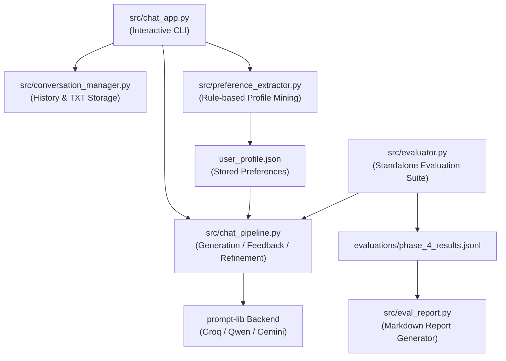

# Core Source Modules (`src/`)

This directory contains the core implementation of the improved **Self-Refine** system, encompassing conversation management, response generation, preference extraction, basic personalization, and the evaluation framework.

---

## Architecture Overview



---

## Module Responsibilities

### 1. Interactive Chat Application (`src/chat_app.py`)
- Provides a clean terminal-based user interface.
- Manages the main menu:
  1. Start a New Chat
  2. Continue Previous Chat
  3. Exit
- Per-turn generation mode selection: asks the user whether to use **Standard Response** (single pass) or **Self-Refine Response** (iterative feedback & refinement) for every message.
- Automatically derives chat titles from the opening user message.
- Integrates graceful rate-limit handling and error recovery.

### 2. Conversation Persistence (`src/conversation_manager.py`)
- Manages independent conversation files under `chats/` (e.g. `chat_001.txt`, `chat_002.txt`).
- Parses and preserves multi-turn message history with timestamp and mode tags:
  ```text
  [2026-11-12 21:00:00] USER [mode: standard]:
  Hello!

  [2026-11-12 21:00:02] ASSISTANT [mode: standard]:
  Hello! How can I help you today?
  ```
- Enforces character-based context window bounds (`DEFAULT_MAX_CONTEXT_CHARS = 4000`) while preserving opening system contexts.

### 3. Response Generation & Refinement Pipeline (`src/chat_pipeline.py`)
- Encapsulates `ChatResponsePipeline`, which orchestrates LLM interactions:
  - **`generate_initial()`**: Produces the initial draft response based on conversation history and active personalization instructions.
  - **`get_feedback()`**: Prompts the critic model to evaluate relevance, accuracy, clarity, and preference adherence, concluding with a normalized score (0–10).
  - **`refine()`**: Takes the prior draft and feedback critique to generate an improved revision.
  - **`generate_chat_response()`**: High-level entry point supporting:
    - `"standard"` mode: Single-pass generation.
    - `"self_refine"` mode: Iterative refinement up to `max_attempts` (default: 2), with convergence early stopping if the initial response scores $\ge 9/10$ or critique states `Critique Summary: None`.
- Loads active style instructions via `load_personalization_instruction()` from `user_profile.json`.

### 4. Preference Extraction (`src/preference_extractor.py`)
- Rule-based, deterministic preference extraction that inspects historical user messages across all saved chats in `chats/`.
- Recognizes recurring stylistic preferences without making external LLM calls:
  - `prefers_step_by_step`: Explanations broken down systematically.
  - `prefers_concise_answers`: Brief, to-the-point responses.
  - `prefers_simple_code`: Minimalist, dependency-free implementations.
  - `prefers_examples`: Practical illustrations and demonstrations.
- Maintains `user_profile.json`, preserving manual user edits (e.g., manually toggling `"enabled": false`).

### 5. Standalone Evaluation Suite (`src/evaluator.py`)
- Headless benchmark runner for comparative evaluation across four experimental configurations (A, B, C, D).
- Records token counts (prompt, completion, total), end-to-end latency, and call telemetry via the `CURRENT` ContextVar.
- Implements an automated **resume mechanism**: reads existing valid records from the output JSONL file and skips already-completed successful prompt/condition combinations.

### 6. Report Generation (`src/eval_report.py`)
- Aggregates raw evaluation records from JSONL files into structured Markdown comparison tables.
- Computes latency ratios, token overheads, success rates, and outlines qualitative evaluation rubrics (correctness, completeness, clarity, preference adherence).

### 7. Legacy Task Runners & Benchmarks
Contains baseline benchmark implementations for the original tasks:
- `src/acronym/`: Acronym generation and scoring.
- `src/commongen/`: Constrained text generation with concept validation.
- `src/gsm/`: Multi-step grade-school mathematical reasoning.
- `src/pie/`: Program improvement for performance and algorithmic efficiency.
- `src/readability/`: Python code readability optimization.
- `src/responsegen/`: Multi-turn dialogue response generation.
- `src/sentiment_reversal/`: Sentiment transfer and reversal.
- `src/experiment.py`: Experiment harness for legacy benchmark A/B/C comparisons.
- `src/output.py`: Redaction and terminal output helpers.
- `src/utils.py`: Prompt base class, retry decorator, and `.env` loader.

---

## Inter-Component Relationships

- **`chat_app` $\to$ `conversation_manager`**: Stores and retrieves conversation transcripts.
- **`chat_app` $\to$ `chat_pipeline`**: Dispatches requests to the LLM according to the selected mode.
- **`chat_pipeline` $\to$ `user_profile.json`**: Reads active preferences to prepend personalized prompt instructions.
- **`evaluator` $\to$ `chat_pipeline`**: Reuses the exact same production generation and refinement pipelines for benchmarking to guarantee fidelity.

